# HLD — Agentic Harness Platform

The high-level design: what the system is made of, how an agent is composed from the
platform, and how a request flows through it. Component internals are in [LLD.md](LLD.md);
the decisions behind them in [ADR.md](ADR.md); terms in
[ubiquitous_language.md](ubiquitous_language.md).

## 1. Architectural style

A **monorepo, modular-monolith runtime**. One Python package, `agent_platform`, is a shared
library of narrow, independently testable subsystems. Three agents compose it:

| Agent | Package | What it does |
|---|---|---|
| Customer Support (`csa`) | `src/customer_support_agent/` | Answers order and refund questions, issues refunds within its authority, queues larger ones for a person, refuses what policy forbids |
| Research (`ra`) | `src/research_agent/` | Answers a plain question directly with web tools; `/research` runs a scoped, contract-bound, independently audited research run |
| Ops Analyst (`ops`) | `src/ops_agent/` | Answers questions about how the agents are running, using only the platform's analytics MCP server |

Each agent runs in its own process inside the platform's Textual console (`make agent <agent>`).
Orchestration inside an agent is **LangGraph**; the platform does not re-implement state
management LangGraph provides. Everything downstream of the model is the **harness**: the
controls you can remove and still have an agent that runs (the declared features), plus the
plumbing that is always on.

## 2. System context

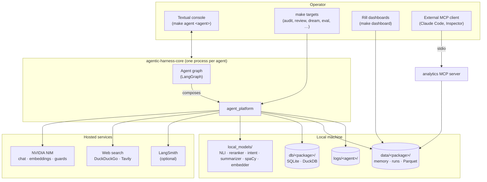

## 3. Platform component map

`agent_platform` keeps its well-known subsystems at the top level and groups small leaves into
four packages. The order below is the order of importance for reading the code.

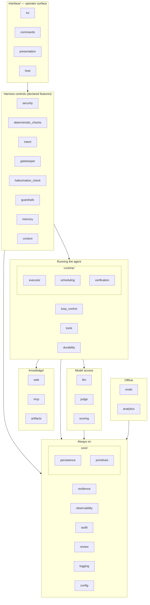

| Group | Package | Responsibility |
|---|---|---|
| — | `config` | Layered YAML → typed settings; the `FeatureSet`; `REPO_ROOT`-relative paths |
| — | `llm` | The only place a provider is called: adapters, `ModelChainBuilder`, rate-limited HTTP, local encoders, metering, PII boundary hook |
| — | `gatekeeper` | Deterministic authority decisions with standings; mandates; RBAC; authority rank |
| — | `tools` | Typed tools, namespaced registry, retrieval-based selection, the single tool path |
| — | `loop_control` | `LoopGovernor`: step cap, budgets, deadline, stagnation, convergence; one `LoopVerdict` |
| — | `hallucination_check` | Claim-level grounding in levels; fact ledger; state model; evidence ledger |
| — | `guardrails` | Structured-output validation and repair; the response guardrail |
| — | `security` | RBAC policy, PII (Presidio + vault), prompt injection, content moderation, guard chains |
| — | `memory` | The four CoALA stores as files; governed writes; dreams; skills; RAG |
| — | `context` | Five-stage context assembly, strategies, failure detection |
| — | `intent` | Intent classifier contracts; Laya and BERT providers |
| — | `deterministic_checks` | The pre-LLM check contract (the business-logic seam) |
| — | `durability` | Checkpointed runs, resume, HITL interrupts, isolated sub-graphs, run controls |
| — | `resilience` | Breaker, retry, timeout, bulkhead, idempotency, saga, hedge, admission, pub/sub, DLQ, rate limiter |
| — | `observability` | Status feed, cards, facts, task/turn bracket, SLOs, cost, LangSmith export |
| — | `audit` | Append-only decision trail; the audit view |
| — | `review` | One human-review queue for every agent |
| — | `logging` | Per-subsystem file logs; `@instrument`; trace id |
| — | `judge` | The shared LLM judge (Template Method) and calibration |
| — | `scoring` | The NOLLM scoring cascade and entailment models |
| — | `evals` | Oracle, DeepEval and Promptfoo graders; intent bake-off; eval store |
| — | `analytics` | Semantic layer, Parquet export, metric catalogue, dummy world, generated Rill dashboards |
| `core/` | `persistence`, `primitives` | SQLite pool and platform tables; money, hashing, keys, PII tokens, clock |
| `interface/` | `tui`, `commands`, `presentation`, `host` | The console, slash commands, plain-text renderers, the `AgentHost` contract |
| `runtime/` | `executor`, `scheduling`, `verification` | Running approved calls; DAG scheduling; effect read-back and acceptance checks |
| `knowledge/` | `web`, `mcp`, `artifacts` | Web gateway (live/record/replay), MCP client and servers, frozen hashed artifacts |

## 4. How an agent is composed

Every agent follows the same composition pattern: a config overlay declares what it is, one
composition root (`graph/builder.py::build_agent`) reads the feature tree once and builds only
what is declared, and an `AgentHost` hands the result to the console.

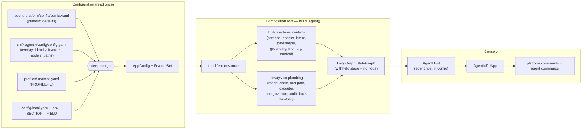

- **Overlays** are named from outside: the Makefile exports `AGENTIC_OVERLAYS` for the agent
  named on the command line. The platform's own `overlays:` is empty.
- **Injection over construction.** Every collaborator of `build_agent` is a keyword argument
  (`llm=`, `pool=`, `gatekeeper=`, `audit=`, `reporter=`, `checkpointer=`, …); anything passed is
  used as is, anything omitted is built from config. Tests and the eval harness substitute what
  they need.
- **A withheld feature is a stage that is never built.** The graph's edges are wired to the next
  stage that exists, so the trace has a gap where the control used to be.
- **`/harness` hot-reloads** the feature tree and rebuilds the agent in the running console;
  nothing is written to disk.

## 5. The three agents

### 5.1 Customer Support

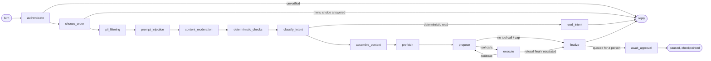

- Every stage between `choose_order` and `prefetch` exists only when its feature is declared
  (`pii`, `prompt_injection`, `content_moderation`, `deterministic_checks`,
  `intent_classification`, `context`); any of them can halt the turn.
- `propose ⇄ execute` is the **tool-use loop**: the model proposes typed calls; the tool path
  (registry → loop governor → Gatekeeper → Executor) decides whether they happen. It is
  deliberately not ReAct.
- `finalize` runs the response guardrail (schema, then the hallucination check). A reply the
  check cuts, and any refund the Gatekeeper escalates, become review items.
- Every turn is a durable run; `await_approval` is a LangGraph `interrupt` resumed by the
  reviewer's decision.

### 5.2 Research

Two paths, chosen by the user (ADR R-01): a plain question goes to the **answer graph**;
`/research` goes to the **scoping graph** and then the **run graph**.

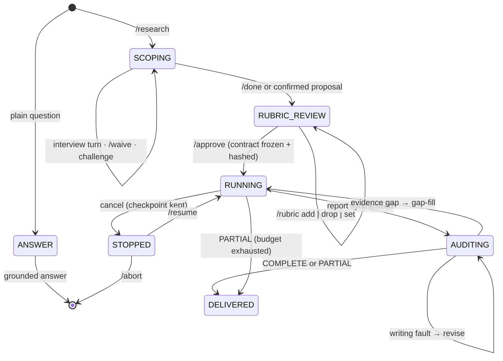

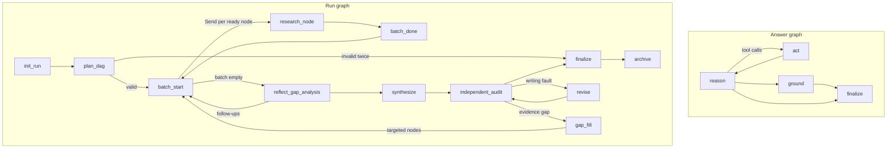

- Scoping pauses on the user every turn (`await_user`, an `interrupt`); termination is enforced
  in code (R-03). The rubric is generated deterministically (R-04).
- Batches are supersteps: one `Send` per ready DAG node, each under the scheduler's semaphore;
  budgets reserved before every await (R-06).
- Only the extractor reads raw page text; the planner, reflector and synthesizer see the
  contract and the ledger's verbatim claims (R-07, R-08).
- The independent audit runs in an isolated sub-graph that accepts exactly
  `(contract, report, ledger_snapshot)` and a judge on a different model (R-11).

### 5.3 Ops Analyst

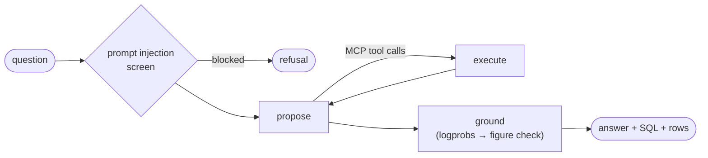

Its only tools are the analytics MCP server's (`list_metrics`, `compute_metric`, `list_views`,
`describe_view`, `run_query`), arriving through the governed MCP client and the same tool path
as any local tool.

## 6. Request lifecycle

### 6.1 A refund turn (Customer Support)

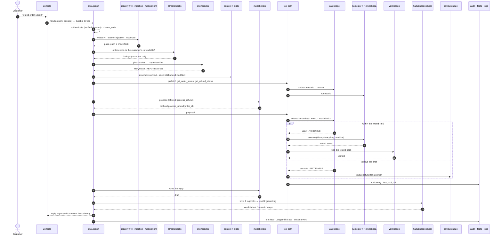

### 6.2 A research run

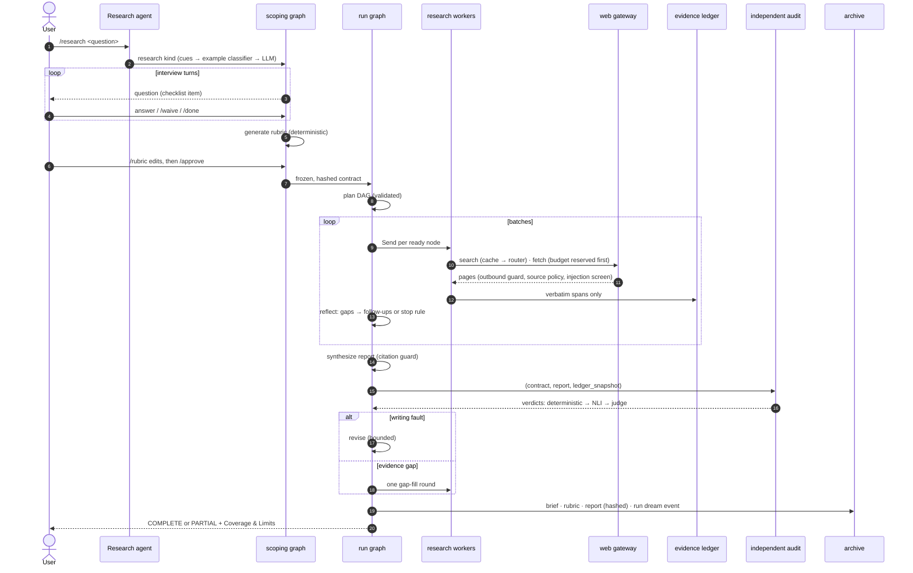

### 6.3 An ops question over MCP

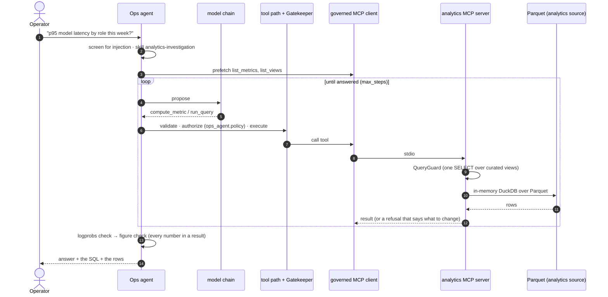

## 7. Cross-cutting concerns

- **The platform names no agent.** It reaches agents through `AgentHost`, `EvalPlugin` and
  config; guard tests enforce it (ADR P-01).
- **Authority is decided, not inferred.** The Gatekeeper reads trusted policy and tool metadata,
  never source plausibility; a record fact belongs to the tool, an authority fact to the
  Gatekeeper (P-09).
- **Exposure is not authorization.** Which tools a turn offers (skills, intent) and whether a
  proposed call may run (Gatekeeper) are separate decisions.
- **A side effect is not believed until it is read back** (P-18).
- **No action is un-audited.** The audit entry is written on every branch, including denials and
  UNGOVERNED calls (P-10).
- **No control state is decorative.** Nothing is logged or shown that no code path produces or
  that cannot change a verdict.
- **The console is a consumer.** File logging (`logs/<agent>/<subsystem>.log`, full payloads,
  never truncated by default) is independent of what is on screen.
- **Everything is configuration.** No value is hard-coded; every path resolves against the repo
  root.

## 8. Deployment view

Single-process, local deployment per agent; several agents (and the MCP server, evals, Rill) may
run at once and share the cross-process rate-limit store.

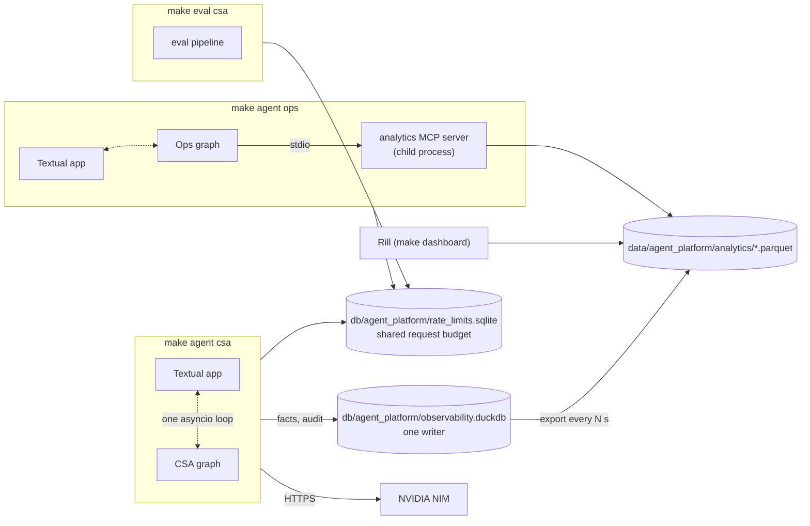

- DuckDB admits one writer: the running console exports Parquet on an interval, and every reader
  (MCP server, Rill) reads the Parquet. Evals use their own store (`evals.duckdb`).
- There is no container isolation; tool execution is in-process (the Docker sandbox is parked —
  [PRD §6](PRD.md#6-parked-and-deferred)).

## 9. Technology stack

| Concern | Choice |
|---|---|
| Orchestration | LangGraph (`StateGraph`, `Send`, `interrupt`, SQLite checkpointer, AES-encrypted) |
| Hosted models | NVIDIA NIM (OpenAI-compatible): chat, embeddings, jailbreak and content-safety guards |
| Local models | Hugging Face Transformers + PyTorch (NLI, reranker, BART summarizer, BERT intent, e5 embedder), Laya decision model, spaCy `en_core_web_lg` for Presidio |
| Web | DuckDuckGo (`ddgs`), Tavily; HTTP fetcher with a reader fallback |
| Persistence | SQLite (agent databases, checkpoints, memory index, rate limits, vector search via sqlite-vec), DuckDB (observability, evals), Parquet (analytics export) |
| Protocols | MCP (official SDK) |
| Console | Textual + Rich, one app |
| Config | pydantic-settings, layered YAML, `SECTION__FIELD` env overrides |
| Tracing | LangSmith (optional), plus the repo's own logs, facts and audit trail |
| Dashboards | Rill (repo-local binary) |
| Evals | DeepEval (optional extra), Promptfoo (pinned, via `npx`) |
| Quality | ruff, mypy `--strict`, pytest with an 80% coverage gate |

## 10. Dependency direction

Dependencies point inward; a lower layer receives a higher capability by injection, never import.

```
core.primitives, config, logging                      layer 0
   └─ core.persistence, llm, resilience                 layer 1
        └─ security, memory, tools, audit, review       layer 2
             └─ context, scoring, guardrails,
                hallucination_check, intent             layer 3
                  └─ gatekeeper, runtime, loop_control,
                     durability, knowledge              layer 4
                       └─ observability, analytics      cross-cutting (read by any layer)
                            └─ evals, judge             offline
                                 └─ interface           consumers only
                                      └─ agents (customer_support_agent, research_agent, ops_agent)
```

`hallucination_check → context → tools → guardrails → hallucination_check` is a known import
cycle broken at call sites; `scoring` is kept a leaf so it stays out of it.
