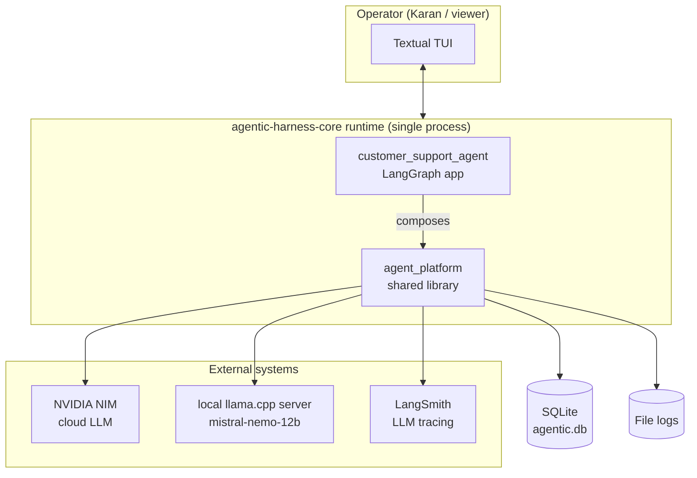
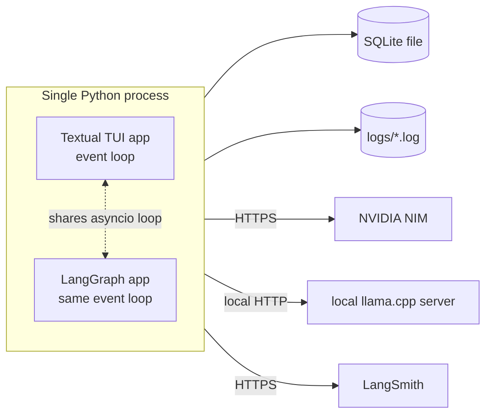

# HLD — Agentic AI Systems Platform (`agentic-harness-core`)

**Companion documents:** `PRD.md` (requirements), `LLD.md` (subsystem design),
`Program_Design.md` (repo layout, phasing, standards).

---

## 1. Architectural style

A **monolith repo, modular-monolith runtime**: one deployable process
(`customer_support_agent` running inside the Textual TUI shell) that
composes a shared library (`agent_platform`) of narrow, independently
testable subsystems. Orchestration inside the running example is
**LangGraph**; the shared library deliberately does *not* re-implement
state management LangGraph already provides — `agent_platform/control_loop`
(parked/TODO this phase — see §3, §8) supplies the FSM *vocabulary and
invariants* (legal-transition checking, checkpoint shape) plus the
`LoopController` watchdog stack, that LangGraph's checkpointer and node
sequence are configured to satisfy, not a competing engine.
`customer_support_agent`'s own `control_loop/` folder composes this
package rather than duplicating its logic once it lands.

Everything downstream of "the model" is the **Harness** (E01). The Harness
is decomposed along the six subsystems the series itself uses as its
organizing spine (E08): **context assembly, output parsing, tool
execution, control loop, state management, error handling** — plus the
cross-cutting disciplines that touch all six: **authority/gatekeeping,
security, memory, evals, observability, resilience.**

## 2. System context diagram



## 3. Component map

Every box below is a real `agent_platform/<name>` package unless marked
otherwise. `customer_support_agent` composes these; it owns no duplicate
logic. Four packages are **parked** (interfaces defined in `LLD.md`,
implementation deferred to a later phase) and one (`multi_agent`) is a
**stub only** (folder exists, no design committed yet) — see
`Program_Design.md` §4 for the phase each unlocks in.

| Component | Responsibility | Status | Owning episodes |
|---|---|---|---|
| `config` | Pydantic-settings config, `SECTION__FIELD` convention, live-read mutable singleton for feature toggles | live | cross-cutting |
| `logging` | Structured, colored, per-subsystem file logging — the source of truth under the TUI | live | cross-cutting |
| `llm` | Provider adapters (NVIDIA NIM, local llama.cpp), model cascading | live | E44 |
| `persistence` | SQLite access, repositories | live | cross-cutting |
| `audit` | Append-only decision ledger; (model, policy, data, authority) version tuples | live | E33 |
| `observability` | Tracer (trace ID propagation), SLOs/error budgets, **cost-stack aggregation** (absorbs what would otherwise be a separate `economics` package — see `LLD.md` §6), Little's-Law queue math | live | E36–E38, E44 |
| `context` | Five-stage context assembly pipeline, context-failure detection, six management strategies, production RAG | live | E08, E17–E19 |
| `memory` | Working/Episodic/Semantic/Procedural stores, write pipeline, poisoning defenses | live | E13–E16 |
| `guardrails` | Pydantic validation, Outlines/LMQL constrained decoding, chaos/property tests | live | E24, E28–E29 |
| `hallucination_protection` | Detection ladder, grounding-vs-reasoning diagnosis, SLOs | live | E25–E27 |
| `gatekeeper` | Sandbox→Gatekeeper→Execution mediation, Authority Hierarchy, Surface Classes, Tier-1/Tier-2, ledger | live | E01–E03, E09, E12 |
| `security` | RBAC/PoLP (`auth`), PII (`pii`), prompt-injection defense (`prompt_injection`), content moderation | live | E10, E30–E32 |
| `resilience` | Circuit breaker, retry, timeout, bulkhead, saga, idempotency, pub-sub | live | E12 (general), E35 |
| `sandbox` | Docker-container execution isolation (full tier ladder documented, only `docker_container` in scope) | **parked, TODO** | E34 |
| `control_loop` | `AgentFSM` (legal-transition table, checkpoint shape) **+** `LoopController` (six-layer watchdog stack) — merged into one package, replacing the earlier separate `state_management`/`loop_engineering` split | **parked, TODO** | E05, E20, E23 |
| `verification` | Effect read-back: re-read what changed, reconcile it against what the action claimed, refuse to call an unverified result authoritative | live | E12, E35 |
| `mcp` | Model Context Protocol contracts. Remote tools arrive as ordinary `ToolDefinition`s through the existing registry, with their governance envelope supplied locally rather than by the server | **parked — interface only** | E42 |
| `multi_agent` | Topologies, A2A, compounding-reliability calculator, coordination cost | **stub only — not designed** | E07, E40–E43 |
| `prompt_compilation` | DSPy signatures/modules/optimizers, prompt-as-artifact versioning | **parked, TODO** | E21 |
| `evals` | Eval Pyramid, NOLLM Scoring Cascade, judge calibration | live | E09–E11 |
| `tools` | Typed `ToolCall`, registry, namespacing, retrieval-based selection | live | E01, E05, E22 |
| `tui` | Live status feed (spinner, human-readable stage labels, token counts, copy). DB browser/memory inspector/audit view designed at interface level | **live status feed only this phase**; panels deferred | cross-cutting |
| `customer_support_agent` | The running product: LangGraph graph, refund/order tools, policy prompts, control-loop composition | live | running example |
| `episodes/eNN` | Minimal `app.py` per episode exercising the harness at that episode's maturity | live | all |
| `design_patterns/` | Independent WF/AG pattern reference implementations | live | M1, M4–M18 |

## 4. Request lifecycle (primary data flow)

This is the canonical flow every episode's cold open is a variation of —
"the same refund process assigned different automation levels" (E03) runs
through this shape regardless of which module is being taught that week.

```mermaid
sequenceDiagram
    participant U as User/Ticket
    participant CSA as customer_support_agent (LangGraph)
    participant CTX as context (assembly)
    participant MEM as memory
    participant LLM as llm adapter
    participant GR as guardrails
    participant HP as hallucination_protection
    participant LC as control_loop.LoopController
    participant GK as gatekeeper
    participant RES as resilience
    participant EXE as tool execution / sandbox (Docker, once built)
    participant OBS as observability/audit

    U->>CSA: ticket / request
    CSA->>CTX: gather_candidates → score → fit_budget → format → order
    CTX->>MEM: retrieve (working/episodic/semantic/procedural)
    MEM-->>CTX: ranked facts
    CTX-->>CSA: assembled context
    CSA->>LLM: completion request (via provider adapter, cascaded)
    LLM-->>CSA: raw output
    CSA->>GR: parse/validate (Pydantic reject/repair OR Outlines/LMQL constrained)
    GR-->>CSA: structured ToolCall or Plan
    CSA->>HP: hallucination detection ladder (if generative claim)
    HP-->>CSA: confidence / verdict
    CSA->>LC: loop-health check (step/time/token/cost/dup/stagnation)
    LC-->>CSA: continue | abort
    CSA->>GK: AuthorityDecision request (surface, actor, authority, cumulative state)
    GK-->>CSA: allow | deny | escalate (Tier-1 authoritative; Tier-2 advisory only)
    alt allowed
        CSA->>RES: execute under retry/timeout/circuit-breaker/bulkhead/idempotency
        RES->>EXE: tool call in sandbox at required isolation tier
        EXE-->>RES: result
        RES-->>CSA: result
    else denied/escalated
        CSA->>OBS: log denial, route to human review queue
    end
    CSA->>MEM: write pipeline (extract→classify→provenance→conflict→confidence→authorize→route)
    CSA->>OBS: trace (PII-filtered) + audit entry (model/policy/data/authority versions)
    CSA-->>U: response
```

> **Reading note.** This diagram is the *target* shape once `control_loop`
> and `sandbox` are built (both currently parked/TODO — see
> `Program_Design.md` §4). Until then, `CSA→LC` and `RES→EXE`'s sandbox
> hop are no-ops/direct calls: the loop-health check and isolation-tier
> selection they represent aren't enforced yet. Every other hop in this
> diagram is real today.

## 5. Cross-cutting concerns

- **Authority is never inferred from source plausibility.** Every request
  into `gatekeeper` is evaluated against the Authority Hierarchy
  regardless of who or what appears to be asking (Zero Trust, E12/E30).
- **Exposure is not authorization.** Which tools a turn offers and which
  actions it authorizes are separate decisions. A side-effecting call
  must be covered by an Action Mandate scoping it to a record the person
  themselves established — never to one the model nominated. Whether they
  *asked* for the action is read by the model; whether it may proceed is
  settled deterministically by the agent's business rules. A keyword list
  standing in for either gets both wrong.
- **A side effect is not believed until it is read back.** "The executor
  returned success" and "the world changed" are different claims. An
  unverified result never becomes authoritative, so no customer-facing
  statement can rest on an action that did not land.
- **The platform names no agent.** `agent_platform` reaches its running
  product through `AgentHost`, resolved from configuration. An agent
  composes the platform; the platform never imports an agent.
- **No action is un-audited.** `observability` and `audit` are invoked on
  every branch of the request lifecycle, including denials — a trace that
  can't reconstruct *why* is telemetry, not audit (E36).
- **No governance feature is decorative.** `config`'s live-toggle
  singleton lets every feature above be switched off mid-run so its
  marginal effect is measurable, not merely asserted (PRD G6).
- **No subsystem re-implements another's discipline.** The NOLLM Scoring
  Cascade (E10) is reused verbatim as `evals`'s judge cascade,
  `context`'s retrieval-tier ordering (E14), `tools`'s selection cascade
  (E22), and `llm`'s model-cascading logic (E44) — one cascade
  implementation, four call sites.
- **Memory type is a semantic decision, not a storage-engine choice**
  (E13) — callers pick a `MemoryStore` implementation by the *nature of
  the fact*, never by convenience.

## 6. Deployment view (v1)

Single-process local/desktop deployment:



No container orchestration, no multi-tenant isolation boundary, in v1 —
`sandbox` (parked/TODO) will implement Docker-container isolation so
tool *execution* can be sandboxed per action even though the *process
itself* is single-tenant; until it lands, tool calls execute in-process,
unsandboxed. Twelve-Factor/canary-release discipline (E39) applies to
config and versioned artifacts (prompt, policy, schema, model, guardrail
rules), not to infrastructure that doesn't exist yet in v1.

## 7. Technology stack

| Concern | Choice | Rationale |
|---|---|---|
| Orchestration | LangGraph | Built-in state management/checkpointing; avoid hand-rolled FSM engine |
| Cloud LLM | NVIDIA NIM (OpenAI-compatible) | Confirmed provider |
| Local LLM | `mistral-nemo-12b` via llama.cpp-style server | Confirmed provider |
| LLM tracing | LangSmith | Confirmed |
| Terminal UI | Rich + Textual (unified single app) | More capable/responsive than Streamlit; demonstrates architect-level tooling |
| Config | pydantic-settings, `SECTION__FIELD` env convention | Except bare provider API keys (`nvidia_api_key`, `hf_api_key`) |
| Persistence | SQLite | Confirmed; browsable via a TUI DB Browser panel once built (deferred — see §3) |
| Structured output | Pydantic (post-hoc) + Outlines/LMQL (constrained decoding) | Both arms taught in E24/E28 |
| Testing | pytest, ruff, mypy --strict | 80%+ coverage gate |

## 8. Module dependency direction

Strict acyclic layering — a lower layer never imports a higher one:

```
config, logging                          (layer 0 — no deps)
   └─ persistence, llm                    (layer 1)
        └─ security, memory, tools, resilience              (layer 2)
             └─ context, guardrails, hallucination_protection  (layer 3)
                  └─ gatekeeper                              (layer 4 — depends on security, resilience, audit)
                       └─ evals, observability, audit         (layer 5 — cross-cutting, may be read by any layer ≤4, never depended on by layer 0-1)
                            └─ verification                            (layer 5b — depends on tools + logging)
        └─ sandbox, control_loop, mcp, multi_agent, prompt_compilation  (layer 6 — parked/stub this phase; see §3)
                                 └─ customer_support_agent      (layer 7 — composes everything)
                                      └─ episodes/, design_patterns/, tui  (layer 8 — consumers only)
```

No `economics` layer entry — cost-stack aggregation lives inside
`observability` (layer 5), not as a separate package (see §3).

`LLD.md` enforces this at the interface level: any subsystem that needs a
capability from a nominally-higher layer receives it via dependency
injection (an interface passed in), never via a direct import.