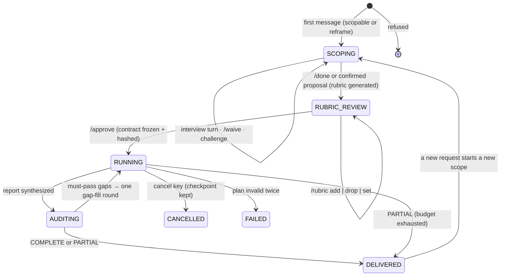
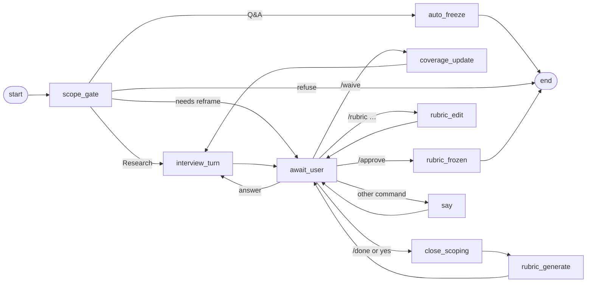
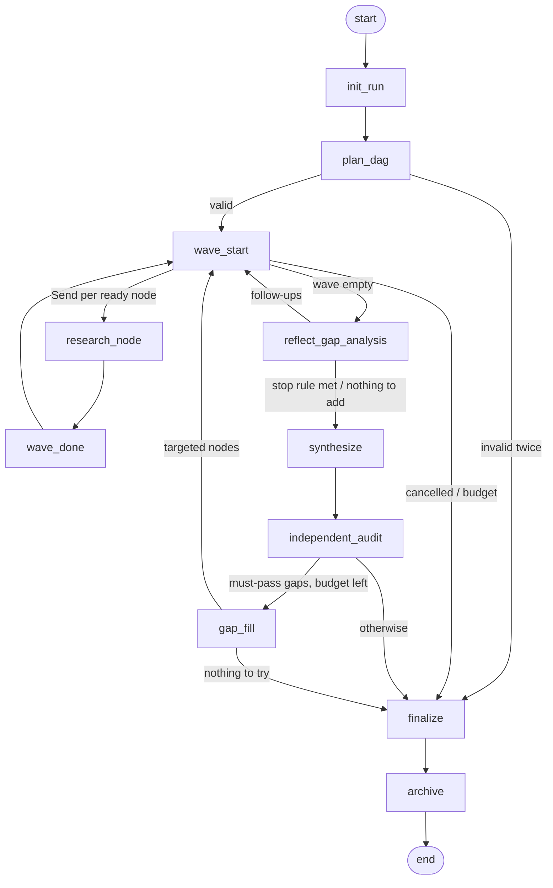
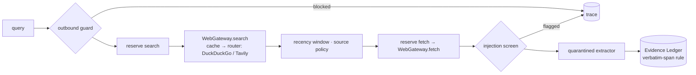
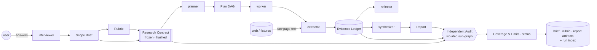

# Architecture

Two LangGraph graphs, both durable through the platform's
`DurableGraphRunner` (SQLite checkpoints, `RunRegistry` rows):

- the **scoping graph** — one thread per scope; it *pauses on the user*
  every turn (`await_decision`, an `interrupt`) and `handle()` resumes it
  with the next message;
- the **run graph** — one thread per approved contract; autonomous from
  `/approve` to delivery.

`ResearchAgent.handle(query, session_id)` dispatches on the session's
phase. Every node reports through `StageReporter` (the TUI's live view)
and every transaction goes to the `AuditLedger`.

## Session phases

With the `rubric` feature withheld there is no `RUBRIC_REVIEW` stage:
`brief_ready` asks the user to approve the Brief itself.

## Scoping graph

- **Q&A** skips the interview: `auto_freeze` builds the Brief from the
  question (and its time window), generates the `qa` rubric, freezes and
  hashes the contract, and the run graph runs it on the Q&A budget.
- **Termination is enforced in code** (`scoping/termination.py`): the
  interviewer may only *propose* done when no required item is open; the
  user confirms. `/done` closes at any time — open items become known
  unknowns. At `scoping.max_turns` the agent stops asking and offers
  `/waive <id|all>` or `/done`.
- **Anti-sycophancy guard** (`scoping_challenge_check`): at least one
  challenge or follow-up every K turns; on violation the interviewer is
  re-prompted once with an explicit challenge instruction, and an audit
  event is written.

## Run graph

- **Waves are supersteps.** `wave_start` computes the ready set from the
  commons `TaskGraph` and fans out one `Send` per node; each
  `research_node` holds a slot of the `AsyncDagScheduler`'s semaphore; a
  checkpoint lands at every wave boundary.
- With `independent_audit` withheld, `synthesize` goes straight to
  `finalize`; with `reflection` withheld the plan runs once.

## One research node (the worker)

Budgets are reserved **before** every await (`BudgetGuard.try_reserve` is a
synchronous check-and-decrement), so concurrent workers on one event loop
cannot overshoot a cap.

## Data flow and what each role may see

Only the **extractor** reads raw page text. The planner, reflector and
synthesizer see the contract, the ledger's verbatim claims and run
bookkeeping — never a page (an oracle invariant, `no_raw_page_text`). The
The independent audit sees exactly three inputs; `IsolatedGraphRunner` refuses any
other key.

## Composition root

`graph/builder.py::build_agent` is the one place features are read and
concrete classes chosen. Anything passed in is used as-is (tests pass a
replaying gateway, in-memory stores; the evals pass recording role
clients and per-case settings); anything omitted is built from config.
A withheld feature is a collaborator that is never built.
